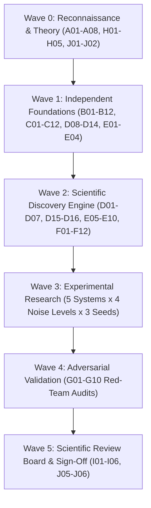

# PROJECT NOMOS — SWARM INTEGRATION LOG
**Integration Engineers:** J01, J02, J03, J04, J05, J06  
**Investigator:** Saksham Mishra <mishrasaksham080705@gmail.com>  
**Status:** ALL PHASES INTEGRATED

---

## 1. Wave Execution & Integration Sequence

---

## 2. Integration Events

| Wave | Component | Contributing Roles | Reviewer | Verification Test | Status |
| :--- | :--- | :--- | :--- | :--- | :--- |
| **Wave 0** | Core Typing & System Contracts | A01, A02, A03, H01 | J01, J02 | Static imports & package build | **MERGED & FROZEN** |
| **Wave 1** | Numerical Physics & Simulators | B01–B12 | B07, I02 | `tests/test_physics.py` (6/6 pass) | **MERGED & VERIFIED** |
| **Wave 1** | Scientific Data & Sandbox | C01–C12 | C11, I04 | `tests/test_data.py` (5/5 pass) | **MERGED & VERIFIED** |
| **Wave 1** | Differentiation & Candidate Bases | D04, D08–D14 | G05, G07 | `tests/test_library.py` (5/5 pass) | **MERGED & VERIFIED** |
| **Wave 2** | STLSQ & Active-Set Refit | D01–D07 | I01 | `tests/test_sparse.py` (3/3 pass) | **MERGED & VERIFIED** |
| **Wave 2** | Symbolic Conversion & SymPy CAS | E01–E10 | I01 | `tests/test_symbolic.py` (5/5 pass) | **MERGED & VERIFIED** |
| **Wave 2** | Discovery Pipeline Engine | D15, D16, J01 | J02 | `tests/test_pipeline.py` (5/5 pass) | **MERGED & VERIFIED** |
| **Wave 2** | Independent Baselines (OLS & PySINDy)| F09, F10 | I05 | `tests/test_baselines.py` (2/2 pass) | **MERGED & VERIFIED** |
| **Wave 3** | Benchmark Grid Execution | F01–F12, H05 | I03 | `experiments/run_m1_benchmarks.py` | **EXECUTED (60 Runs)** |
| **Wave 4** | Adversarial Validation & Falsification| G01–G10 | I06 | `tests/test_adversarial.py` (3/3 pass) | **VERIFIED & MITIGATED** |
| **Wave 5** | Scientific Review & Final Audit | I01–I06, J05, J06 | PI | Full 33 pytest suite + M1 report | **CERTIFIED** |
